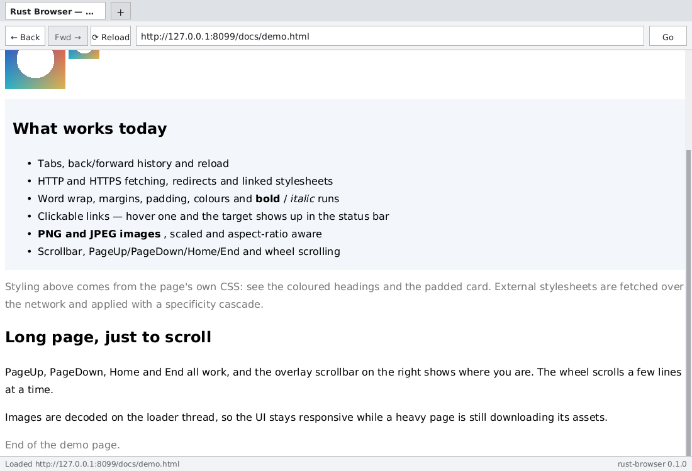

# rust-browser

**A web browser written from scratch in Rust** — its own HTML parser, its own CSS engine, its own layout and its own software rasteriser. No Chromium, no WebKit, no JS engine: just ~4 000 lines of readable Rust that turn an URL into pixels.

Repository: **[github.com/AlexanderNyr/AuraLite-Browser](https://github.com/AlexanderNyr/AuraLite-Browser)**

[winit](https://github.com/rust-windowing/winit) opens the window, [softbuffer](https://github.com/rust-windowing/softbuffer) hands us a raw `u32` framebuffer, and everything that appears inside that framebuffer — the browser chrome *and* the page — is drawn by the code in this repository.


```console
$ cargo run                    # start page
$ cargo run -- example.com     # open a URL (https:// is assumed)
$ cargo run -- http://127.0.0.1:8000/index.html
```

---

## What it does

| Area | Status |
| --- | --- |
| HTTP / HTTPS fetching (rustls), redirects, `Content-Type` charset sniffing | ✅ |
| HTML5-ish tokenizer + DOM builder (void tags, raw-text elements, entities, implied `</p>` / `</li>`) | ✅ |
| `<style>` blocks and `<link rel="stylesheet">` (fetched over the network) | ✅ |
| CSS cascade: tag / `.class` / `#id` / descendant selectors, specificity, `!important`-free UA defaults | ✅ |
| Block layout with margin collapsing, padding, explicit widths/heights | ✅ |
| Inline formatting: word wrap, per-run bold/italic, text alignment, `<br>`, inline images | ✅ |
| Text rasterisation with `fontdue` (bundled DejaVu, antialiased, synthetic oblique) | ✅ |
| PNG / JPEG images: background download (6 workers), decoding, nearest-neighbour scaling, aspect-ratio aware sizing | ✅ |
| Tabs (Ctrl+T / Ctrl+W / Ctrl+Tab), per-tab back/forward history, reload | ✅ |
| Scrolling: wheel, PageUp/PageDown, Home/End, arrow keys, overlay scrollbar | ✅ |
| Clickable links + hover URL preview in the status bar | ✅ |
| Two-phase loading: the document appears as soon as the HTML is in, images stream in behind it | ✅ |
| Forms, tables, floats, flexbox/grid, `position`, JavaScript | ❌ not yet — see [Roadmap](#roadmap) |

Honest limits: this is a *small* engine, not a standards-compliant one. It renders simple, content-oriented pages (documentation, blogs, plain HTML) well and modern app shells not at all. Heavier pages — Wikipedia, for instance — load and scroll, but their float/`position`-based layouts come out overlapping, because those formatting models are still on the roadmap.




## Architecture

A page travels through seven independent, individually testable stages:

```
 ┌──────────┐   ┌──────────┐   ┌──────────┐   ┌──────────┐   ┌──────────┐
 │ net.rs   │ → │ html.rs  │ → │ css.rs   │ → │ layout.rs│ → │ render.rs│
 │ fetch    │   │ DOM      │   │ computed │   │ box tree │   │ pixels   │
 │ bytes +  │   │ tree +   │   │ styles + │   │ absolute │   │ framebuf │
 │ headers  │   │ title    │   │ cascade  │   │ coords   │   │ (u32)    │
 └──────────┘   └──────────┘   └──────────┘   └──────────┘   └──────────┘
        ↑                                                          ↓
   browser.rs (tabs, history, async loading)  ←  app.rs (winit window, chrome, input)
```

| Module | Responsibility |
| --- | --- |
| `src/net.rs` | `ureq` fetch with rustls, redirect following, charset decoding, `normalize_url` / `resolve_url` for the address bar and relative links. |
| `src/html.rs` | Hand-written tokenizer → DOM (`Document`, `Element`, `Node`). Handles void elements, `<script>`/`<style>` raw text, entity decoding, implied paragraph/list closing, synthesises `<html>/<head>/<body>` if missing. |
| `src/image.rs` | PNG/JPEG decoding into `0xRRGGBB` pixels, alpha flattened onto white, plus the per-page `ImageStore` that resolves relative `src` URLs. |
| `src/css.rs` | Hand-written CSS parser, selector matching, specificity-based cascade, inherited properties, UA stylesheet, `ComputedStyle` per element. |
| `src/layout.rs` | Produces a box tree in absolute page coordinates: block stacking with margin collapsing, inline runs with greedy word wrap, `text-align`, link hit-testing. |
| `src/render.rs` | `FontSet` (measurement shared with layout so wrapping matches drawing exactly), glyph rasterisation, alpha blending, image blitting, `Framebuffer` primitives with a clip rectangle — all on a plain `&mut [u32]`. |
| `src/browser.rs` | `Tab` (URL, title, history stack, scroll offset, layout cache) and `Browser` (tab list, active tab). Loading runs on a worker thread and reports back through an `mpsc` channel, so the UI never blocks. |
| `src/app.rs` | winit `ApplicationHandler`: tab strip, toolbar, address bar, status bar, keyboard shortcuts, mouse hit-testing in both chrome and page. Everything is drawn with the same software rasteriser into one framebuffer. |

Because the renderer only needs a `&mut [u32]`, the whole pipeline can run **headlessly** — that is what the tests and the `examples/` do.

## Keyboard shortcuts

| Shortcut | Action |
| --- | --- |
| `Ctrl+T` / `Ctrl+W` | new tab / close tab |
| `Ctrl+Tab` / `Ctrl+Shift+Tab` | next / previous tab |
| `Ctrl+L` | focus the address bar (`Esc` leaves it) |
| `Ctrl+R`, `F5` | reload |
| `PageUp` / `PageDown` / `Space` | scroll one viewport |
| `↑` / `↓` | scroll a few lines |
| `Home` / `End` | top / bottom of the page |
| `Alt+←` / `Alt+→` | back / forward |
| `Enter` | navigate to what is in the address bar |
| mouse wheel | scroll the page |
| click a link | follow it; hovering shows the target in the status bar |

With **no scheme typed**, `example.com` becomes `https://example.com`; `localhost:8000` becomes `http://localhost:8000`.

## Supported CSS

`color`, `background` / `background-color`, `font-size` (`px`, `%`, `small|medium|large`), `font-weight`, `font-style: italic`, `display: none | block | inline`, `text-align: left | center | right`, `text-decoration: underline`, `line-height`, `margin` (+ per-side), `padding` (+ per-side), `width`, `height`.

Colours accept `#rgb`, `#rrggbb`, `rgb()`, `rgba()` and ~25 named colours. Lengths accept `px`, `%` and unitless zero.

Everything else is parsed, ignored, and documented as missing — no silent best-effort guessing.

## Tests and examples

```console
$ cargo test          # 35 tests: parser, cascade, layout, wrapping, images, scrolling, render, end-to-end
$ cargo clippy --all-targets -- -D warnings
```

Two headless examples show the engine without a window:

```console
$ cargo run --example render_png       # parses, styles, lays out and writes target/smoke.png
$ cargo run --example dump file.html   # prints the laid-out box tree with coordinates
$ cargo run --example fetch example.com    # fetches a page and reports bytes/sheets/images
$ cargo run --example profile example.com  # stage-by-stage timings: fetch, parse, css, layout, render
```

`docs/demo.html` is the page used for the screenshots above (it pulls `docs/logo.png`) — serve the repository root with any static server and open `http://127.0.0.1:8000/docs/demo.html`.

## Prebuilt Windows build

A ready-to-run 64-bit Windows binary is produced by cross-compiling with the MinGW toolchain:

```console
$ rustup target add x86_64-pc-windows-gnu
$ sudo apt install gcc-mingw-w64-x86-64          # Linux host
$ cargo build --release --target x86_64-pc-windows-gnu
# -> target/x86_64-pc-windows-gnu/release/rust-browser.exe
```

The result is a single ~4.5 MB `.exe` that links only against system DLLs (`user32`, `gdi32`, `bcrypt`, `ws2_32`, …) — no runtime to install, Windows 10 or newer. Release builds use the GUI subsystem, so no console window appears; build in debug mode (`cargo build`) if you want stderr diagnostics.

Pushing a tag (`git tag v0.1.0 && git push --tags`) makes `.github/workflows/release.yml` build Linux, Windows and macOS binaries and attach them to the GitHub release.

## Build requirements

Rust 1.75+ and a Linux/macOS/Windows desktop. On Debian/Ubuntu the winit X11 backend needs:

```console
$ sudo apt install libxkbcommon-x11-0 libx11-dev libxcursor-dev libxrandr-dev libxi-dev
```

Fonts are bundled in `assets/fonts` (DejaVu Sans, Bitstream Vera licence), so nothing depends on the host's font setup.

## Roadmap

Ordered roughly by usefulness per line of code:

1. **Floats and `position`** — the single biggest rendering win: most real pages (Wikipedia included) rely on them, and today their content overlaps.
2. **Bookmarks and session restore** — `browser.rs` already keeps tabs and history, so this is mostly persistence (JSON in `~/.config`).
3. **Find in page** — the layout tree has text runs; a simple substring highlight pass would do.
4. **CSS growth** — `border`, `border-radius`, `em`/`rem`/`vh`, `max-width`, `margin: auto` centring.
5. **Forms** — `<input>`, `<textarea>`, `<button>`, `GET` submission.
6. **Tables and flexbox** — the box model is ready for a real formatting-context enum.
7. **Incremental rendering** — lay out and paint only the visible slice of a very long page instead of the whole tree.
8. **TLS/UX niceties** — certificate info panel, an encoded-URL display, a proper error page with retry.

## Licence

MIT — see [LICENSE](LICENSE). Bundled fonts are DejaVu Sans, distributed under the Bitstream Vera licence (see `assets/fonts/LICENSE-DejaVu.txt`).
